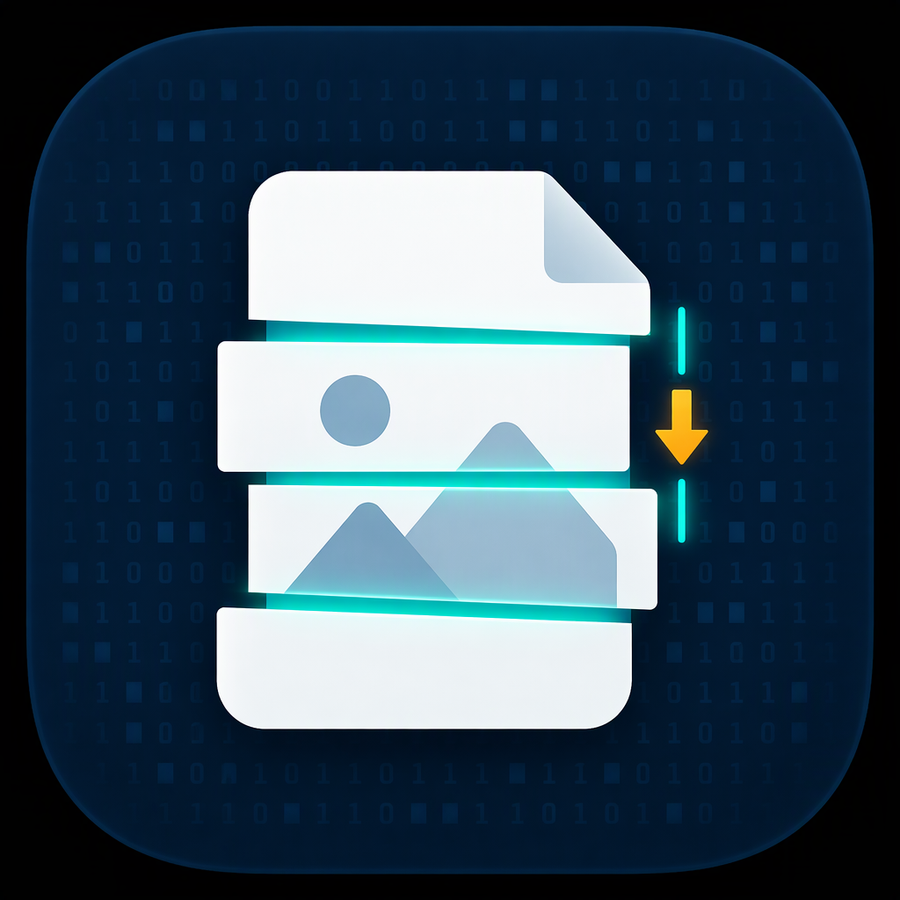

<p align="center">
  
</p>

<h1 align="center">OpenRecover</h1>

<p align="center">
  <a href="LICENSE"></a>
  
  
  
</p>

Read-only deleted-file recovery for disks and disk images. The primary target is Windows x64;
Linux builds are used for image and container testing. The project never writes to a source
device, source image or Android device — see [docs/READONLY_POLICY.md](docs/READONLY_POLICY.md).

## Status

Milestones M0–M5 are implemented. The repository builds the `openrecover_core` library, the
`openrecover` command-line tool and the test suite, and passes the milestone gates
`ctest -L "M[0-5]"`. M0 covers the read-only I/O core, M1 partition tables, FAT32, exFAT and ext4,
M2 NTFS, M3 carving, M4 the Android bridge, and M5 the CLI, reports, end-to-end tests, fuzz
targets and packaging.

Versions 1.0.0 through 1.4.0 are released and frozen; the archives ship as
[GitHub Releases](https://github.com/CGRLabs/openrecover/releases). Version 1.1.0 is
additive and library-first: exFAT and VHD readers, thirteen carved formats, a swept container
parser and a `find_package`-able package. Version 1.2.0 adds ext4. Version 1.3.0 adds VHDX
containers and JPEG fragment reassembly. Version 1.4.0 completes carving reassembly: a JPEG
split more than once, a PNG cut inside its image data and a GIF cut on a frame boundary are
joined piece by piece, each chain kept only when it ends at the format's terminator. See
[RELEASE_NOTES.md](RELEASE_NOTES.md).

The tree is between cycles and stays on the released 1.4.0 baseline so `--version` matches the
artifact in `dist/`; a new cycle bumps the version and refreshes the report goldens in the same
first step (see `docs/DECISIONS.md`, "1.1.0 is the frozen baseline between cycles").

## Scope

Implemented capabilities:

- Open Windows physical drives (`\\.\PhysicalDriveN`), Windows volumes, Linux block devices and
  flat image files (`.dd`, `.img`, `.raw`, `.bin`) through a read-only `BlockDevice`. Fixed and
  dynamic VHD containers are read by their virtual geometry: the block allocation table and the
  per-block sector bitmaps are followed, and unallocated blocks and sectors read back as zeros.
  VHDX containers are read the same way: the file identifier, both headers and region tables (with
  their CRC32C checksums), the metadata region that names the virtual size and block and sector
  sizes, and the block allocation table with its sector bitmaps. Not-present, undefined and zero
  blocks read back as zeros.
- Partition tables (MBR, GPT) and filesystem metadata for FAT32, exFAT, NTFS and ext4. exFAT
  recovery uses the allocation bitmap to judge whether a deleted file's clusters were reused,
  follows surviving FAT chains, honours the `NoFatChain` flag, and traverses deleted directories
  whose entries are still intact. ext4 recovery reads the superblock's feature set and checksum
  seed, the block-group descriptors and their CRC32c, the inode tables, extent trees and inline
  `i_block` data, and falls back to the pre-extents indirect-block layout; a deleted file's name
  is paired with its body only when the deletion timestamp is unambiguous, and the block bitmap
  decides whether its blocks were taken after the unlink. A volume whose features change the bytes
  or the metadata layout -- encryption, compression, casefold, bigalloc, `meta_bg` -- is refused as
  `Unsupported` instead of being decoded as if those features were absent.
- Structure-aware carving of JPEG, PNG, PDF, ZIP, GIF, BMP, TIFF, WAV, SQLite and ISO media files
  (MP4, QuickTime, M4A, 3GPP, HEIF), RIFF AVI video, MPEG audio and legacy Office documents in
  compound-file containers in unallocated space. A JPEG whose head stops at a discontinuity is
  joined to the contiguous run where its entropy stream resumes, when that run validates to `EOI`;
  a PNG cut inside its image data is joined to the chunk run whose CRC verifies through `IEND`;
  a GIF cut on a block boundary is joined to the frame run whose LZW streams decode through the
  trailer.
  Each hit keeps its extents in `report.json`, is exported and hashed as the logical file, and is
  reported `Low` confidence with the `Fragmented` flag.
- Original paths for NTFS soft deletes. When a deleted file sits in `$Recycle.Bin`, its `$I`
  sibling still records where the file came from, when it was deleted and how big it was; the scan
  reads that metadata, reattaches the path, and says so in the report.
- NTFS compressed files. An LZNT1 `$DATA` is expanded while its record is read: the attribute's
  compression-unit width, the hole after each unit and the verbatim units are all followed, so a
  deleted compressed file is recovered as its original bytes instead of being skipped.
- Pulling still-accessible items from an Android device over ADB, without root.
- A deterministic JSON report and CSV manifest, and export of recovered files into a chosen
  output directory.

Not implemented, by design: any write, repair or format operation; iOS; macOS/APFS/HFS+/ReFS; cloud
recovery; E01/VMDK containers and differencing VHD/VHDX disks (a differencing disk needs its parent
chain); NTFS alternate data streams, encrypted (EFS) files and
sparse-file reconstruction; the recycle bin of filesystems other than NTFS (FAT keeps deleted paths
in `INFO2` and exFAT keeps no metadata at all); Android root or physical imaging; a GUI; any network
functionality.
Unsupported inputs return `ErrorCode::Unsupported` with a descriptive message.

## Read-only design in brief

- `BlockDevice` exposes only `info()`, `read()` and `bad_sectors()`. There is no write, flush,
  trim, resize, ioctl passthrough or raw-handle accessor, and tests fail to compile if one appears.
- Windows device handles are opened with exactly `GENERIC_READ`, `FILE_SHARE_READ` and
  `OPEN_EXISTING`. Device-control requests go through an allowlist of read-only geometry queries;
  anything else throws `ReadOnlyViolation`.
- Linux opens with `O_RDONLY|O_CLOEXEC|O_LARGEFILE` and verifies `F_GETFL`.
- `OutputSink` is the only writer. It refuses an output directory that contains the image or
  resides on the source disk, never overwrites an existing file, writes to a temporary name and
  commits without replacement, and rejects path traversal and symlink escape.
- The exported package carries no write path either: `find_package(OpenRecover)` gives a consumer
  `BlockDevice`, the scanners, the carve engine and `OutputSink`, which is the only class in the
  public headers that creates a file.
- `tools/check_readonly.py` scans the source for forbidden write/ioctl/driver-install APIs; on
  Linux a `strace` test proves the source is opened read-only and never written.

## Limitations

### Windows share-mode caveat

If another process (Windows itself, antivirus, search indexing) holds the drive open with write
access, an open with `FILE_SHARE_READ` only fails with `ERROR_SHARING_VIOLATION` (32). OpenRecover
then returns `DeviceBusy` and refuses to continue. Take the disk offline (Disk Management →
*Offline*) or attach it through a hardware write-blocker, then retry.

`OpenOptions.allow_shared_write_sharing` (exposed by the CLI as `--allow-shared-write-sharing`)
retries once with `FILE_SHARE_READ | FILE_SHARE_WRITE`. Access remains
`GENERIC_READ`: the flag only permits *other* processes to write, never OpenRecover itself. The
fallback is logged as a warning and recorded in the report (`"shared_write_fallback": true`).
Allowing other processes to modify the disk during recovery can change what remains recoverable,
so a write-blocker is always preferable.

### Android scope (no root)

Without root, ADB grants access only to shared storage and app-accessible areas exposed to the
`shell` user. “Recovery” there means collecting items that still exist as files in accessible
locations (thumbnails, caches, trash/recycle folders); true undelete of app-private data is not
possible. The bridge never runs `su`, `adb root` or `adb remount`, never installs, pushes or
deletes anything on the device, never changes settings or reboots, never reads `/dev/block` or
another app's `/data`, and never attempts privilege escalation. Paths denied by the OS are
reported as `AccessDenied`.

Every Android report states its limitations: inaccessible app-private data, encrypted `/data`,
scoped-storage restrictions on Android 11+, and that low-level undelete requires root or physical
imaging (out of scope).

### Fragmented files (JPEG, PNG and GIF)

A carved hit is one contiguous run unless the format can prove its own continuation. Three formats
reassemble. JPEG works on markers: when a head stops at a discontinuity — someone else's bytes
where a marker should be — the engine searches from the next allocation-unit boundary for scan
data, and keeps walking from each cut to the next until the bytes reach `EOI`. Every piece becomes
its own extent: the hit is `Low` confidence with the `Fragmented` flag, `report.json` counts the
extents in `fragments` and lists each one's device `offset` and `length` under `extents`
(contiguous hits carry neither key), and the exported file and its SHA-256 are the pieces
concatenated. A chain that reaches its terminator is the whole file, so the hit is not
`Truncated`; a dropped chain leaves the head flagged `Truncated` and alone. A run shorter than one allocation unit is skipped rather than exported, a chain is
limited to eight extents, the search may not resume more than `CarveOptions::max_reassembly_gap`
past the last attributed byte, and a chain that never reaches `EOI` is dropped — the head then
stands alone as a truncated hit. The walk refuses at another image's `SOI`, so a neighbouring
JPEG's header and frames are not mistaken for a continuation.

PNG works on checksums. A head stops at the first chunk whose length, type or CRC no longer checks
out — but only when the bytes where that chunk says it ends are not themselves a valid chunk
boundary; if they are, the file's structure survived and the candidate is rejected whole instead
of being called a cut. The search resumes on a chunk whose CRC verifies (its successor must also
start a plausible header) and walks chunk by chunk to `IEND`. It refuses to start at `IEND` alone,
and refuses once it meets another PNG's signature, so a neighbouring image is never absorbed. The
extent, confidence, eight-piece and gap rules above are the same, and a run that never reaches
`IEND` is dropped back to a truncated head. A cut that lands exactly on a chunk boundary has no
broken chunk of its own to show, so what follows the head decides: bytes that cannot open a chunk
turn it into a cut at the boundary and the tail is joined, while bytes that parse as a plausible
header with a length running past the source make the head a truncation that claims everything to
the end of the source, with no tail to join.

GIF has no checksums, so its proof is arithmetic. A head stops at the first block that fails to
parse — but only once a frame has completed, because a GIF whose bytes have not proven themselves
is still just rejected — while bytes that fail the LZW decode are corruption rather than a cut,
and the candidate is rejected whole, the way PNG treats a failed inflate. The search resumes on a
block that is valid on its own terms: an image whose LZW stream decodes to exactly the declared
pixel count, or a graphic-control, application or plain-text extension whose fixed structure
checks out — a comment block's free-form chain parses anywhere and is never claimed. The walk
continues block by block to the trailer and refuses once it meets another GIF's header, so a
neighbouring image is never absorbed. The extent, confidence, eight-piece and gap rules above are
the same, and a run that never reaches the trailer is dropped back to a truncated head. A cut
lands where it lands: the interrupted frame's remaining sub-blocks sit in the gap and are
unprovable, so the tail joins at the next frame's introducer and the recovered copy of that frame
decodes short.

Nothing else is guessed: a PDF, ZIP, BMP or media file cut by later writes is still truncated
at the discontinuity or rejected by its validator. A zero-filled gap carries no marker, so a JPEG
tail reads it as entropy: a tail whose real start sits inside a zero run is joined with those
zeros included, which inflates its length and hash — the hit still says `Low` and `Fragmented`.
Bytes between the cut and the next boundary are never exported. Under an unallocated-only scan a
gap piece that touches a cluster marked in use is refused as well — those bytes belong to whatever
file owns the cluster now — and the chain is dropped back to its truncated head. Files recovered
from filesystem metadata are not affected, because their extents are known. The CLI reassembles by
default (`--no-reassemble` turns it off); for library consumers `carve::CarveOptions::reassemble`
defaults to `false`.

## Command-line usage

The CLI never writes to the source. Every command accepts `--json` (machine-readable output) and
`-v`/`-vv` (debug/trace logging); output files are written only through `OutputSink`.

```text
openrecover devices [--json]
openrecover partitions --source  [--sector-size N] [--json]
openrecover scan      --source  [--fs auto|fat32|ntfs|exfat|ext4] [--partition N | --offset N]
openrecover recover   --source  --out <dir> [--mode metadata|carve|both]
openrecover carve     --source  --out <dir> [carve options]
openrecover verify    --report <dir>/report.json
openrecover android scan --serial <S> --out <dir> [--profile <json>] [--adb-backend subprocess|python]
openrecover android pull --serial <S> --out <dir> [--profile <json>] [--adb-backend subprocess|python]
```

`--mode both` first exports filesystem entries, then carves only unallocated space and skips hits
that duplicate an already exported file. Carving options: `--scope unallocated|all`,
`--min-confidence low|medium|high`, `--types jpeg,png,pdf,zip,gif,bmp,tiff,wav,sqlite,mp4,avi,mp3,cfb`, `--max-size type=bytes`,
`--unaligned`, `--deep` and `--no-reassemble`. `recover` and `carve` write `report.json` and `manifest.csv` into the
output directory. `verify` re-hashes every exported file and exits non-zero on a mismatch.

Exit codes: `0` success, `1` generic error, `2` usage error, `3` permission denied, `4` device
busy, `5` unsupported filesystem, `6` output on the source, `7` Android device unauthorized,
`70` read-only violation (refused write attempt).

On Windows, physical drives must be taken offline (Disk Management) or attached through a
write-blocker; see the share-mode caveat above.

## Using the library

The library is the product; the CLI is a consumer of it. `openrecover/openrecover.hpp` is the
umbrella header for the stable surface. At the top of it is `openrecover/recover.hpp`: the
high-level API that opens a source, chooses the volume, exports and carves, and hands back a
`report::Report`. Under it sit the pieces that API is built from — `io::open_source`,
`partition::scan_partitions`, `fs::detect_and_open`, `carve::CarveEngine`, `io::OutputSink` and
`report::Report`. The per-format signature classes, the per-filesystem scanners and the platform
device backends are installable headers too, but they are internals — include them directly only if
you accept that they change.

```cpp
#include "openrecover/openrecover.hpp"

using namespace openrecover;

SourceRequest source;
source.source = "D:\\images\\card.img";      // a file, \\.\PhysicalDrive1 or /dev/sdb

auto sink = io::OutputSink::open("D:\\recovered", io::SourceIdentity::from_source_string(source.source));
if (!sink) return exit_code_for_error(sink.error());

RecoverRequest request;
request.source = std::move(source);
request.sink = sink->get();                  // the one writer; the source is never written to
request.filter.min_confidence = Confidence::High;
request.carving.options.unaligned = true;    // deleted files rarely start on a cluster boundary
request.carving.options.reassemble = true;   // join a JPEG or PNG head to the pieces after a gap

auto report = recover(request);              // open, choose the volume, export, carve, finalize
if (!report) return exit_code_for_error(report.error());
report::write_to_sink(**sink, *report, "report.json", "manifest.csv");
```

`recover()` is the whole pipeline in one call. Its three steps are public on their own for a tool
that needs to interleave them with its own work: `open_volume(request, need_scanner)` returns an
`OpenedSource` (the chosen volume, its partition table, its filesystem scanner and the warnings
gathered on the way), `export_metadata` writes the files the directory still names, and
`carve_and_export` recovers the rest by signature. `ExportFilter` (confidence floor, type list,
per-type size cap) applies to both phases, so a report says exactly what was asked for.

```sh
cmake --preset win-msvc-release
cmake --build --preset win-msvc-release
cmake --install build/win-msvc-release --prefix /opt/openrecover
```

Then in a consumer project:

```cmake
find_package(OpenRecover 1.2 REQUIRED)          # CMAKE_PREFIX_PATH=<install prefix>
add_executable(mytool src/main.cpp)
target_link_libraries(mytool PRIVATE OpenRecover::core)
```

`examples/recover_image.cpp` is a complete ~90-line program that does what `openrecover recover`
does: it opens a source, exports what the metadata still names, carves what the metadata lost, and
writes `report.json` and `manifest.csv`. It links the installed-style target and is run against the
committed fixtures by the `example_runs` test, so a public API break fails the normal build instead
of the release. `tests/unit/test_recover_api.cpp` pins the façade's behaviour against the same
fixtures and the CLI goldens. Every byte either one writes goes through `io::OutputSink`; the source
stays read-only.

## Building

Requirements: CMake 3.24 or newer, Ninja, a C++20 compiler (MSVC 19.38+, Clang 16+, GCC 12+) and
Python 3 (for the static read-only check). Third-party dependencies (tl::expected, nlohmann/json,
CLI11, Catch2, miniz) are fetched by CMake `FetchContent` and pinned by URL and SHA-256.

Windows (Developer PowerShell for VS 2022):

```sh
cmake --preset win-msvc-release
cmake --build --preset win-msvc-release
ctest --preset win-msvc-release -L "M[0-5]" --output-on-failure
```

From Git Bash, run the commands inside the Visual Studio environment via the provided wrapper:

```sh
cmd //c "tools\dev\msvc.bat cmake --preset win-msvc-debug"
cmd //c "tools\dev\msvc.bat cmake --build --preset win-msvc-debug"
cmd //c "tools\dev\msvc.bat ctest --preset win-msvc-debug -L \"M[0-5]\" --output-on-failure"
```

Linux:

```sh
cmake --preset linux-clang-debug        # or linux-gcc-release
cmake --build --preset linux-clang-debug
ctest --preset linux-clang-debug -L "M[0-5]" --output-on-failure
```

All builds use warnings-as-errors. The available presets are `win-msvc-debug`,
`win-msvc-release`, `linux-clang-debug` and `linux-gcc-release`.

## Testing

Tests use Catch2 and are grouped by milestone label (`M0` through `M5`), so each gate can be run
with `ctest -L Mn`, or all of them with `ctest -L "M[0-5]"`. The suite covers byte-level parsing,
image/partition/cache I/O, the exact Win32 open arguments (through an injected fake), the
read-only type constraints, `OutputSink` path rules, FAT32/exFAT/NTFS/ext4 recovery and fixtures, carving
validators, the Android bridge (fake adb and subprocess transports), reports, the CLI, and the
static and syscall-level read-only checks. `tests/e2e/cli_e2e.py` additionally runs the real CLI
against the committed images, compares golden reports (with `generated_at` masked), checks
determinism, probes tamper detection, and on Linux runs the whole pipeline under `strace`.

Long-running stress tests are opt-in: `cli_stress_sparse` creates a 2 GiB sparse image, and
`-DOPENRECOVER_NIGHTLY_TESTS=ON` adds a 64 GiB variant labelled `M5-nightly`.

Three tests guard the surface rather than the internals. `test_recover_api` drives the high-level
API on the real fixture images and asserts the same numbers the CLI goldens pin, including the
volume-selection rules (a pinned partition, a pinned offset, a forced filesystem, a source with no
filesystem at all) and that a progress callback returning false cancels. `example_runs` executes
`examples/recover_image.cpp` against every committed image and checks that the report's file and
carve entries match the bytes actually on disk, that a partition-less image still yields carved
files, and that a hit duplicating a metadata-recovered file is not exported twice.
`install_layout` installs the package into the build tree and audits it without a compiler: the
export set must reference only installed archives, no build-tree path may leak into the generated
CMake files, and every quoted include in every installed header must resolve inside the package.

Run the static scanner directly, including its negative self-test:

```sh
python3 tools/check_readonly.py
python3 tools/check_readonly.py --selftest
```

## Fuzzing

The libFuzzer targets live in `fuzz/` and require clang on Linux with `-fsanitize=fuzzer`
(the Windows clang libFuzzer runtime uses a static CRT and is not supported). They run each
parser over an in-memory `MemoryDevice` with ASan and UBSan:

```sh
cmake -S . -B build/fuzz -G Ninja -DCMAKE_BUILD_TYPE=RelWithDebInfo \
  -DCMAKE_C_COMPILER=clang -DCMAKE_CXX_COMPILER=clang++ \
  -DOPENRECOVER_BUILD_TESTS=OFF -DOPENRECOVER_BUILD_FUZZ=ON
cmake --build build/fuzz
./build/fuzz/fuzz/fuzz_ntfs_record -max_total_time=60 tests/fixtures/fuzz/ntfs_record
```

Targets: `fuzz_fat32_boot`, `fuzz_fat32_dir`, `fuzz_ext4_super`, `fuzz_ext4_dir`,
`fuzz_ext4_inode`, `fuzz_ntfs_record`, `fuzz_ntfs_runlist`, `fuzz_lznt1`, `fuzz_sig_jpeg`,
`fuzz_sig_png`, `fuzz_sig_pdf`, `fuzz_sig_zip`, `fuzz_sig_gif`, `fuzz_sig_bmp`, `fuzz_sig_tiff`,
`fuzz_sig_wav`, `fuzz_sig_sqlite`, `fuzz_gpt`, `fuzz_vhd` and `fuzz_vhdx`. CI
runs each for 60 seconds on every push. Seed corpora are committed under `tests/fixtures/fuzz/` and
can be regenerated with `python tools/fixtures/make_fuzz_corpus.py`. The signature corpora mark
seeds that must be rejected with an `invalid_` prefix, and the M3 signature tests assert that
convention so the corpora stay meaningful without a fuzzer.

Because the libFuzzer targets only build on Linux, the container and signature parsers also
carry mutation sweeps that run everywhere. `test_vhd_device` flips every byte of a valid fixed
and dynamic container, then rewrites each footer and header field and repairs the checksum that
covers it, so the parser has to judge the value instead of stopping at the checksum gate.
`test_vhdx_device` does the same for a VHDX: every byte, then every header, region-table,
metadata and BAT field with the covering CRC32C repaired. Every
one of those mutants must either be refused with `CorruptStructure`, `Unsupported` or
`InvalidArgument`, or open as a device that keeps its promises: reads never cross the end of the
mapped disk, and two overlapping reads agree about the same byte.

## Packaging

CPack produces a ZIP archive on Windows and a `.tar.gz` on Linux:

```sh
cmake --build --preset win-msvc-release --target package
```

The archive contains the executable, the Android profiles and adb sidecar, and the documentation
under `share/doc/openrecover`. It is also a CMake package: `lib/openrecover_core.lib` (or `.a`) and
`libopenrecover_miniz` plus `include/openrecover/**`, `include/tl/expected.hpp` and
`lib/cmake/OpenRecover/OpenRecoverConfig.cmake`, so `find_package(OpenRecover)` works straight out
of the archive. Real-device procedures are in `tests/manual/` and are not part of the package or CI.

The `install_layout` test audits the package's structure — export set against installed files, no
build-tree paths, every quoted include resolving inside the archive. Consuming it from outside the
repository is a manual release step, because it needs a real out-of-tree link:

```sh
unzip build/win-msvc-release/openrecover-<version>-windows-x64.zip -d /tmp/sdk
cmake -S consumer -B /tmp/consumer-build -DOpenRecover_DIR=/tmp/sdk/lib/cmake/OpenRecover
cmake --build /tmp/consumer-build
```

A consumer that only `#include "openrecover/openrecover.hpp"`, links `OpenRecover::core`, and calls
`io::open_image_raw`, `report::Report` and `carve::SignatureRegistry::builtins()` must compile, link
and print the same version and signature list the CLI reports.

## Documentation

- [docs/READONLY_POLICY.md](docs/READONLY_POLICY.md) — the normative read-only rules and where
  each is enforced.
- [docs/DECISIONS.md](docs/DECISIONS.md) — dated record of every ambiguity resolved during
  implementation.
- [docs/SPEC.md](docs/SPEC.md) — the implementation specification.
- [docs/CONTRIBUTING.md](docs/CONTRIBUTING.md) — how to build, test and send changes.
- [CHANGELOG.md](CHANGELOG.md) — release history; full narratives in [RELEASE_NOTES.md](RELEASE_NOTES.md).

## License

MIT — see [LICENSE](LICENSE). Released artifacts are frozen and published as GitHub Releases.
Dependencies are fetched
by CMake and are all permissively licensed: tl::expected (MIT), nlohmann/json (MIT), CLI11
(BSD-3-Clause), miniz (MIT-like zlib-style license), Catch2 (BSL-1.0), and `third_party/sha256.h`
(CC0). Each archive ships its own license text next to the fetched sources.
